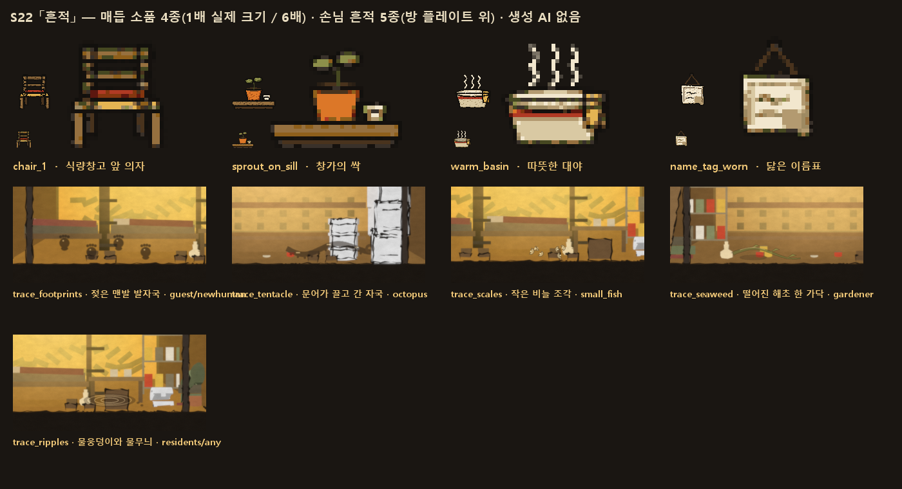
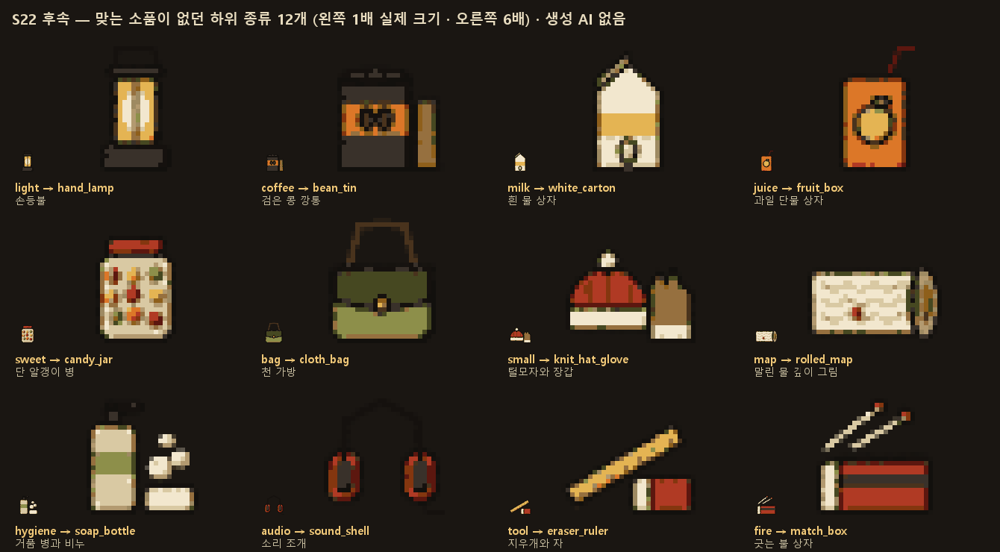
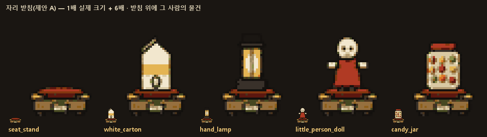

# 배경 S22 1단계 「흔적」 (2026-10-11)

생성기는 `tools/gen_knot_props.py`(신규)다. 선반 소품을 만든 `tools/gen_props.py`의 Sprite·snap·brushed를 import해서 그대로 쓴다. 그래서 34종과 같은 화풍(평면 2단 음영, 흙 팔레트, 흔들리는 손그림 선)이고 같은 팔레트로 스냅된다. 생성 AI는 쓰지 않았다. 기존 소품 PNG 34장은 md5가 같다(바이트 동일).

## 1. 매듭 소품 4종 — `static/art/props/`
| id | 1배(34×30) | x4 | 맥락 | 그림 |
|---|---|---|---|---|
| `chair_1` | `chair_1.png` | `x4/chair_1.png` | arcs.json 25행, 「앉아서 먹는 저녁」 1단계 `set_prop` | 등받이 살 둘인 나무 의자에 자주색 방석. "아직 아무도 안 앉은" 빈 의자 |
| `sprout_on_sill` | `sprout_on_sill.png` | `x4/…` | arcs.json 262행 `after.prop` | 창턱 위 흙 그릇에 떡잎 둘 + 옆에 젖은 천 끝 |
| `warm_basin` | `warm_basin.png` | `x4/…` | arcs.json 415행 `after.prop` | 칠한 띠가 있는 법랑 대야, 따뜻한 물(크림색), 걸친 수건, 김 세 줄 |
| `name_tag_worn` | `name_tag_worn.png` | `x4/…` | arcs2.json 162행 `after.prop` | 못에 끈으로 건 천 이름표. 바느질 테, 해진 귀퉁이, 손때 자국, 읽히지 않는 손글씨 두 줄 |

- 메타: `props_meta.json`에 새 블록 **`"knots"`**를 넣었다. 키는 위 id이고, 값은 기존 형식(name·slots·w·h·file·file4x)에 kind·context를 더했다. 기존 `"props"` 34개는 그대로다.
- 주의: `gen_props.py`를 다시 돌리면 `props_meta.json`을 새로 써서 `"knots"`가 지워진다. 그 뒤에 `gen_knot_props.py`도 다시 돌리면 된다(`_knots_note`에 적었다).
- 김은 따뜻한 크림색이다. 차가운 발광은 쓰지 않았다(사용자 피드백 "괴기스럽다"). 물도 청록이 아니라 크림색이다. 소품 팔레트에는 청록이 없다.

## 2. 손님 흔적 덧씌움 5종 — `static/art/decor/` (반투명, 알파 포함)
| 파일 | 크기 | 무엇 | 어울리는 손님(visitor) |
|---|---|---|---|
| `trace_footprints.png` | 180×48 | 젖은 맨발 발자국 넷 | guest · newhuman |
| `trace_tentacle.png` | 150×46 | 문어가 끌고 간 젖은 자국 + 빨판 점 | octopus |
| `trace_scales.png` | 80×34 | 등불을 받아 반짝이는 작은 비늘 몇 조각 | small_fish |
| `trace_seaweed.png` | 120×40 | 바닥에 떨어진 해초 한 가닥 + 젖은 자리 | gardener |
| `trace_ripples.png` | 120×40 | 작은 물웅덩이 + 동심원 + 물방울 | residents · any |

- 메타: `decor_meta.json`에 **`"traces"`** 블록을 넣었다(id·파일·크기·anchor(아래 가운데)·visitors).
- 놓는 자리: `corner_spots_in_cell` = 칸 좌표 (200,272)·(370,272)·(300,276). 방 바닥 면이고, 두 서는 자리(84·480) 사이다.
- 그리는 순서: 플레이트 위, 사람 아래.
- 색은 따뜻한 진갈색 물기에 등불색 반짝임이다.

## 3. 유물 하위 종류(relic_templates `_subtypes` 49개) → 소품 34종 대응 확인
✓ 잘 맞음 · △ 비슷하지만 약함 · **✗ 맞는 소품 없음**

| 갈래 | 하위 종류 | 가장 가까운 소품 | 판정 |
|---|---|---|---|
| food | noodle 면 | `prop_noodle_box` | ✓ |
| food | snack 과자 | `prop_crisp_bundle` | ✓ |
| food | canned 통조림·절임 | `prop_dry_jar` (항아리, 깡통 아님) | △ |
| food | grain 곡물·밥 | `prop_seed_sack` | ✓ |
| food | sweet 단것 | (`prop_crisp_bundle`) | **✗** |
| food | sauce 양념 | `prop_long_neck_bottle` (음료 병) | △ |
| drink | water 물 | `prop_flat_canteen` | ✓ |
| drink | soda 거품 음료 | `prop_cap_heap` | ✓ |
| drink | coffee 커피 | — | **✗** |
| drink | tea 차 | `prop_dry_leaf_box` (담배 갈래 소품) | △ |
| drink | milk 우유 | (`prop_white_crock`) | **✗** |
| drink | juice 과일 음료 | (`prop_empty_bottle_row`) | **✗** |
| drink | alcohol 술 | `prop_long_neck_bottle` | ✓ |
| medical | pill 알약 | `prop_twelve_cell_box` | ✓ |
| medical | ointment 연고 | `prop_white_crock` | ✓ |
| medical | disinfect 소독 | `prop_brown_vial` | △ |
| medical | bandage 붕대 | `prop_rolled_strips` | ✓ |
| medical | cosmetic 바르는 것 | `prop_white_crock` | △ |
| medical | hygiene 씻는 것 | — | **✗** |
| medical | tonic 기운 내는 병 | `prop_brown_vial` | ✓ |
| electronics | battery 건전지 | `prop_cell_tin` | ✓ |
| electronics | cable 줄 | `prop_tangled_light_thread` | ✓ |
| electronics | device 기기 | `prop_black_panel` | ✓ |
| electronics | light 조명(손등불·유리 불씨) | (`prop_tangled_light_thread`) | **✗** |
| electronics | audio 소리 | — | **✗** |
| electronics | part 부품 | `prop_gauge_piece` | ✓ |
| stationery | pen 펜 | `prop_stick_bundle` | ✓ |
| stationery | paper 종이·공책 | `prop_pressed_paper_stack` | ✓ |
| stationery | sticky 붙이는 메모 | `prop_color_chip_pile` | ✓ |
| stationery | toy 장난감 | `prop_little_person_doll` | ✓ |
| stationery | tape 테이프·풀 | `prop_rolled_strips` (붕대) | △ |
| stationery | tool 지우개·자 | — | **✗** |
| stationery | document 서류 | `prop_loose_leaf_box` | △ |
| book | manual 설명서·요리책 | `prop_stacked_books` | ✓ |
| book | field_guide 도감 | `prop_standing_books` | △ |
| book | map 지도 | — | **✗** |
| book | story 이야기책 | `prop_standing_books` | ✓ |
| book | ledger 장부·사전 | `prop_stacked_books` | △ |
| book | index 목록책 | `prop_fused_block` | △ |
| apparel | shirt 옷 | `prop_folded_cloth` | ✓ |
| apparel | shoes 신발 | `prop_single_boot` | ✓ |
| apparel | label 이름표 | `prop_name_patch_box` | ✓ |
| apparel | coat 겉옷·작업복 | `prop_hung_coat` | ✓ |
| apparel | small 장갑·양말·모자 | (`prop_folded_cloth`) | **✗** |
| apparel | bag 가방 | — | **✗** |
| tobacco | smoke 담배 | `prop_thin_paper_box` (+ `prop_foil_bundle`) | ✓ |
| tobacco | liquor 술 | `prop_sealed_flask` | ✓ |
| tobacco | beer 맥주 | `prop_empty_bottle_row` | △ |
| tobacco | fire 불붙이개 | — | **✗** |
| unknown | any | `prop_nameless_box` · `prop_unread_lump` | ✓ |

**맞는 소품이 없는 하위 종류 12개(✗)**:

| 갈래 | 하위 종류 |
|---|---|
| food | sweet |
| drink | coffee · milk · juice |
| medical | hygiene |
| electronics | light · audio |
| stationery | tool |
| book | map |
| apparel | small · bag |
| tobacco | fire |

**약함(△) 11개**:

| 갈래 | 하위 종류 |
|---|---|
| food | canned · sauce |
| drink | tea |
| medical | disinfect · cosmetic |
| stationery | tape · document |
| book | field_guide · ledger · index |
| tobacco | beer |

새 그림은 아직 그리지 않았다(지시대로). 그린다면 우선순위를 이렇게 권한다:
1. **light**(손등불) — 이 게임의 주제(어둠 속 불빛)와 직결된다.
2. **coffee·milk**(자주 찍히는 편의점 품목).
3. **bag·small**.
4. **map**(수심 그림).

쓰는 하위 종류가 없는 소품: `prop_fused_block`·`prop_foil_bundle`은 보조로만 쓰인다.

## 4. 자가 검수 (03_BG §5)
1. 주색 하나와 등불 하나: 소품이라 해당이 적다. 흔적의 반짝임만 등불색이다. **예.**
2. 초록과 사는 흔적: 싹(올리브)이 있고, 의자·이름표·대야는 "누군가 여기 산다"는 흔적이다. **예.**
3. 안/밖: 해당 없음(방 안 소품).
4. 격자 소품: 흔적은 구석에 하나씩만 둔다. **예.**
5. 용량·회귀: 새 PNG 13장(1배 4 + x4 4 + 흔적 5). 기존 소품은 바이트 동일. **예.**

## 5. 원칙
- B4(오늘 밤 누가 잔다 — 사람 흔적)
- B9(흔적은 스스로 생긴 것처럼, 구석에)
- REF_ART_FLAT_FOLK §1·§5(평면 2단, 흙 팔레트, 청록 금지)
- P3(자리 비운 사이의 작은 발견)

커밋하지 않았다.

---

# S22 후속 — 맞는 소품이 없던 하위 종류 12개 (2026-10-11)

| 하위 종류 | 갈래 | 소품 id | 이름 | 그림 |
|---|---|---|---|---|
| light | electronics | `prop_hand_lamp` | 손등불 | 고리 손잡이, 철 바구니, 따뜻한 유리와 불꽃 빛 |
| coffee | drink | `prop_bean_tin` | 검은 콩 깡통 | 검은 깡통에 주황 띠와 콩 둘, 옆에 가루 막대 봉지 |
| milk | drink | `prop_white_carton` | 흰 물 상자 | 뾰족 지붕 종이갑, 노란 띠, 물방울 표식 |
| juice | drink | `prop_fruit_box` | 과일 단물 상자 | 주황 상자에 과일과 잎, 빨대 |
| sweet | food | `prop_candy_jar` | 단 알갱이 병 | 색 알갱이 가득한 병, 빨간 뚜껑 |
| bag | apparel | `prop_cloth_bag` | 천 가방 | 올리브 천 가방, 덮개, 단추, 끈 |
| small | apparel | `prop_knit_hat_glove` | 털모자와 장갑 | 방울 털모자 + 장갑 한 짝 |
| map | book | `prop_rolled_map` | 말린 물 깊이 그림 | 반쯤 펼친 두루마리, 추상 등고선, 표시 점(실제 지형 아님) |
| hygiene | medical | `prop_soap_bottle` | 거품 병과 비누 | 펌프 병, 비누, 거품 |
| audio | electronics | `prop_sound_shell` | 소리 조개 | 머리띠 소리통과 줄 |
| tool | stationery | `prop_eraser_ruler` | 지우개와 자 | 비스듬한 자 + 종이 띠 지우개 |
| fire | tobacco | `prop_match_box` | 긋는 불 상자 | 반쯤 밀린 성냥갑과 성냥 둘 |

## 1. 파일과 메타
- 그림: `static/art/props/<id>.png`(34×30) + `x4/<id>.png`.
- 메타: `props_meta.json`에 두 블록을 넣었다.
  - **`subtype_props`**: 위 12개. 기존 형식에 subtype을 더했다.
  - **`by_subtype`**: 서버·클라이언트가 바로 읽는 표다. 구조는 `by_subtype[category][subtype] = {prop, match, file, file4x}`.
    - 49개 하위 종류 전부(+ unknown.any)를 덮는다.
    - match는 good(잘 맞음) 27(unknown.any 포함) / weak(비슷함) 11 / new(이번에 새로 그림) 12다. 약한 11개는 지시대로 그대로 두었다.

## 2. 생성기와 회귀
- 생성기: `tools/gen_knot_props.py subtypes`(하위 종류만) 또는 인자 없이(전부).
- 생성기들이 서로의 블록을 지우지 않게 했다.
  - `gen_knot_props.py`는 자기 블록만 바꾼다.
  - `gen_props.py`는 "자기가 쓰지 않는 블록은 그대로 둔다"로 고쳤다(3줄). 다시 돌려도 knots·subtype_props·by_subtype이 남는다.
- **주의**: `gen_props.py`는 시드에 `hash()`를 써서 실행할 때마다 붓결이 달라진다. 34종의 바이트를 지키려면 다시 돌리지 않는 것이 안전하다.
- 회귀: 기존 PNG(소품 34 + 매듭 4 + 흔적 5, 1배·x4)는 md5 검사로 전부 바이트 동일하다.
- 직접 보고 고친 것: 거품 병의 거품이 외곽선 때문에 1배에서 검은 점(때)으로 보였다. 외곽선 없는 밝은 방울로 바꿨다.

---

# S22 후속 2 (2026-10-13)

## (1) 비늘 흔적을 키웠다
- `trace_scales.png`: 80×34 → **150×46**. 비늘 7 → 14조각, 크기 1.5배, 진한 테와 결, 밑에 젖은 자리를 넣었다.
- 이제 발자국·문어 자국과 같은 밀도다. 1280 화면 비율의 플레이트 위에서 다시 확인했다.
- `decor_meta.json` traces의 크기와 anchor도 갱신했다.
- 생성: `python tools/gen_knot_props.py scales`(비늘과 보관 자리만 다시 만든다).

## (2) 보관 자리(잠자리·앉는 자리) — `decor_meta.json` → **`keepsake_spots.by_plate`**
좌표는 칸 좌표(564×317)이고, 각 점이 소품의 아래 가운데다. 그 방 사람 순서대로 앞에서부터 쓴다.

| 플레이트 | 자리 |
|---|---|
| quarters | 침대 넷: 아래 칸 (128,216)·(272,216), 위 칸 (128,127)·(272,127) |
| infirmary | 침상 둘: (150,244)·(322,244) |
| workshop | 작업대 위: (300,205)·(190,205) |
| greenhouse | 화단 턱: (175,229)·(400,229) |
| storage | 벽 선반 맨 위 (350,87) · 바닥 (250,272) |
| power | 장 위 턱 (430,196) · 바닥 (250,274) |

- 침대가 그려진 플레이트는 quarters·infirmary 둘뿐이다. 나머지는 앉는 자리·턱·선반이다.
- plates_meta 캔버스(672×378) 좌표로 바꾸려면 +54, +33.
- `plates_meta.json`은 `blender_section.py`가 다시 쓰는 파일이라 넣지 않았다.
- `gen_decor.py`도 다시 돌릴 때 다른 블록(traces·keepsake_spots)을 남기도록 고쳤다.

## (3) 끝 매듭 「자리」 그림 — 제안(아직 그리지 않음)
서버가 끝 매듭에서 하는 일은 `cres(st, r["id"])["seat"] = {"arc", "item", "day"}`, 즉 **그 사람이 건넨 물건 하나가 그 방에 영구 장식이 된다**는 것이다. 끝 매듭 11개를 보면 이렇다.

| 끝 매듭이 남기는 것 | arc |
|---|---|
| 소품이 이미 있다 | `chair_1`(arc_cook_seat 첫 매듭), `sprout_on_sill`(farmer_color), `warm_basin`(engineer_warm), `name_tag_worn`(trader_unpack) |
| 자세·말만 | cook_seat(seated_evening), scout_window(창가 잠자리), scholar_page(해독실 저녁 낭독), scout_names |
| 아무것도 없음 | medic_seal, kid_sweet, cook_feast, farmer_bowl |

**제안 A(권장): 공통 그림 하나 + 기존 소품 얹기.** 새로 그리는 것은 **「자리 받침」 한 장(34×30 + x4)**뿐이다.
- 받침의 모양: 작은 둥근 방석, 그 위에 손때 묻은 나무 받침, 앞에 작은 이름 천 고리. 따뜻한 등불색 테두리 한 줄로 "이 사람 것"이 보이게 한다.
- 받침 위에 그 사람의 seat.item을 `by_subtype`의 소품으로 얹는다. 위치는 그 사람의 `keepsake_spots`다.
- 끝 매듭에 고유 소품(after.prop)이 있는 4개는 받침 대신 그 소품을 쓴다.
- 장점: 어떤 물건이 와도 맞고, 소품 표(50개)를 그대로 재사용한다. 새 그림 한 장이라 시간과 용량이 거의 들지 않는다.

**제안 B: 역할별 자리 다섯 장.**

| 역할 | 자리 |
|---|---|
| 요리사 | 마주 놓인 의자 둘 + 그릇 둘 |
| 정찰병 | 창가 잠자리(돌아누운 침구) |
| 의무관 | 뜯지 않은 봉인 상자 한 칸 |
| 아이 | 단것 병 하나를 올린 낮은 상자 |
| 학자 | 저녁 낭독용 등 받친 걸상 |

- 농부·기술자·상인은 기존 매듭 소품을 쓴다.
- 장점: 각 이야기의 끝이 그림으로 다르다.
- 단점: 다섯 장이 들고, 새 이야기가 늘 때마다 그림이 따라가야 한다. 물건(item)은 안 보인다.

**권장은 A다.** 「자리」의 뜻이 "그 사람이 건넨 물건이 남는다"(서버 seat.item)이므로, 물건이 보이는 쪽이 맞다. 합의되면 받침 한 장을 그리겠다.

## (3) 확정 — 「자리 받침」 (제안 A 승인, 2026-10-13)

- 파일: `static/art/props/seat_stand.png`(34×30) · `x4/seat_stand.png`.
- 그림: 손때 묻은 낮은 나무 받침, 등불색 윗판 테, 둥근 자주색 방석, 앞에 매단 이름 천(읽히지 않는 이름).
- 메타: `props_meta.json` → **`seat_stand`**
  - `item_floor_y` 18: 그 사람의 물건(by_subtype 소품, 같은 배율)의 아래 가장자리를 방석 윗면에 맞춘다. 받침을 먼저 그리고 물건을 그 앞에 그린다.
  - `own_prop_arcs`: 받침 대신 매듭 소품을 쓰는 넷(arc_cook_seat→chair_1, arc_farmer_color→sprout_on_sill, arc_engineer_warm→warm_basin, arc_trader_unpack→name_tag_worn).
  - 놓는 자리는 `decor_meta.json`의 `keepsake_spots`다.
- 생성: `python tools/gen_knot_props.py seat`.
- 기존 소품 PNG는 md5가 같다(바이트 동일).
