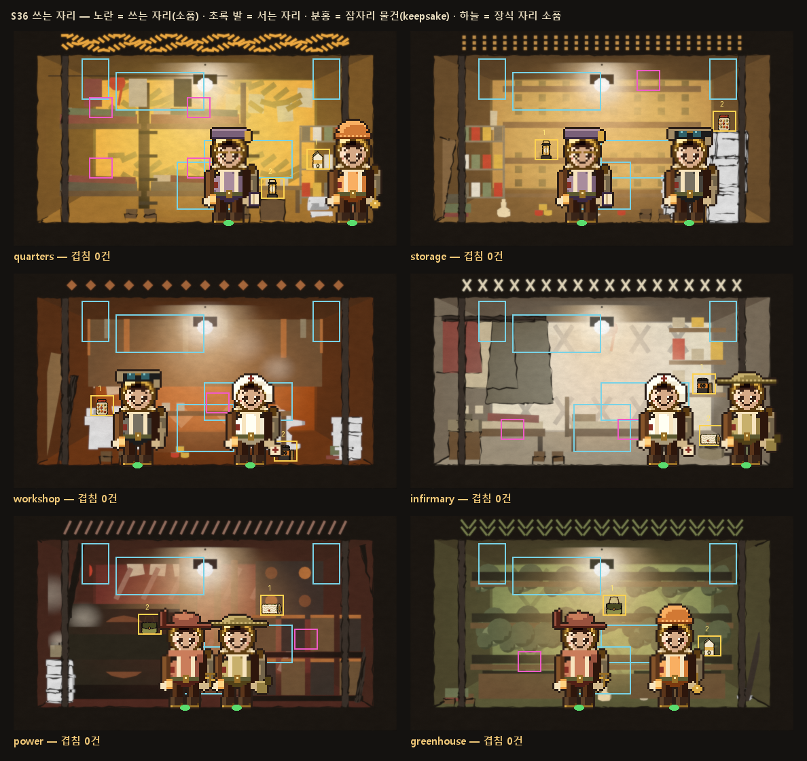

# 배경 S36 — 건넨 물건을 방에서 쓰는 자리 (2026-10-25)

생성기는 `tools/gen_use_spots.py`(신규)다. 데이터만 만들었고, 그림 파일은 새로 만들지 않았다.

## 산출 — `static/art/decor/decor_meta.json` → **`use_spots`**
- **`by_plate[플레이트] = [ {kind, item:[x,y], stand:[x,282], note} ×2 ]`**
  - 좌표는 칸 좌표(564×317)다.
  - `item` = 물건(by_subtype 소품, 34×30 1배)의 아래 가운데.
  - `stand` = 쓰는 사람의 발 가운데.
- `room_to_plate`: 방 id → 플레이트. base_core.js `PLATE_OF`와 같은 대응이다.

  | 방 | 플레이트 |
  |---|---|
  | quarters · decoder | quarters |
  | pantry · storage · lounge | storage |
  | infirmary · bath | infirmary |
  | workshop | workshop |
  | greenhouse · well | greenhouse |
  | generator · power | power |

  플레이트를 함께 쓰는 방은 같은 자리를 쓴다(전용 플레이트가 생기면 따로 잡는다).
- `overlap_check`: 생성기가 센 겹침 수. 6개 플레이트 모두 **0**이다.

| 플레이트 | 쓰는 자리 1 (item → stand) | 쓰는 자리 2 (item → stand) |
|---|---|---|
| quarters | 오른쪽 책장 가운데 칸 (448,203) → 498 | 책상 아래 궤짝 위 (381,246) → 316 |
| storage | 벽 선반 아래 칸 (200,189) → 252 | 높은 짐 더미 꼭대기 (462,147) → 410 |
| workshop | 작업대 왼쪽 흰 상자 위 (130,209) → 182 | 작업대 오른쪽 끝 바닥, 의자 옆 (400,276) → 348 |
| infirmary | 약 선반 아래 칸 (432,177) → 372 | 선반 밑 낮은 상자 위 (442,253) → 494 |
| power | 오른쪽 장 윗면 (380,146) → 328 | 왼쪽 기계 윗면 (200,174) → 252 |
| greenhouse | 가운데 화분 선반 (300,146) → 248 | 아래 화분 선반 오른쪽 (440,206) → 388 |

## 확인 방법
- 겹침 검사는 생성기가 상자끼리 직접 센다. 쓰는 자리(34×30)를 다음 셋과 비교한다.
  - 잠자리 물건(`keepsake_spots`)
  - 장식 자리 소품(`slot_positions_in_cell`의 선반 받침·고리·받침대 영역)
  - 같은 방의 다른 쓰는 자리
- 6개 플레이트 모두 0건이다.
- 접촉 시트(위)는 실제 소품과 주민(P2 ×3)을 서는 자리에 세워 합성한 것이다.
  - 노랑 = 쓰는 자리, 초록 발 = 서는 자리, 분홍 = 잠자리 물건, 하늘 = 장식 자리.
  - 처음엔 서는 자리를 물건 바로 앞에 두어 사람이 물건을 가렸다. 그래서 물건 옆 약 50px로 옮겼다. 몸 반폭이 약 32px라서다.
  - 같은 방 두 사람이 서로 겹치던 곳(infirmary)과, 사람이 다른 물건을 가리던 곳(quarters)도 다시 잡았다.

## 남은 것
- 쓰는 자리 중 일부는 기존 서는 자리(84·480) 기둥 안에 있다(workshop 1, quarters 1, infirmary 2). 그 칸에 다른 사람이 기본 자리로 서 있으면 물건이 가릴 수 있다. 클라이언트가 그릴 때 물건을 사람 뒤에 둘지 앞에 둘지 정해야 한다.
- 전용 플레이트가 없는 방(pantry·decoder·lounge·bath·well)은 대응 플레이트의 자리를 같이 쓴다.
- 커밋하지 않았다.
