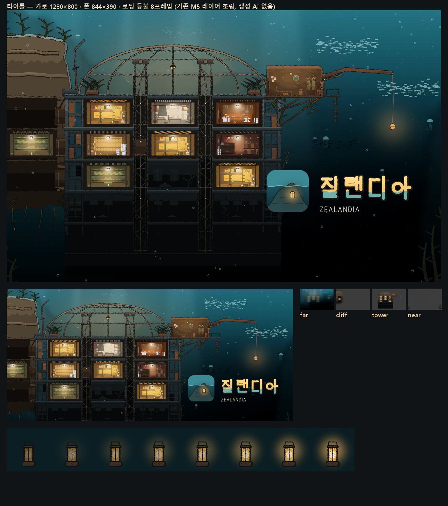

# 배경 — 타이틀·로딩 그림 (2026-10-13)

생성기는 `tools/gen_title.py`(신규)다. **기존 M5 레이어만 조립했다**(back·cliff·tower_shell·승강로·입구·해치·방 플레이트·front·생물 아틀라스). 생성 AI는 없다. 로고는 기존 `static/art/brand/zealandia/`(로고 A 「가라앉은 대륙의 창」)를 그대로 쓰고, 새로 만들지 않았다.

## 산출 — `static/art/title/` (합계 약 1.27MB)
| 파일 | 내용 |
|---|---|
| `landscape_far.jpg` · `landscape_cliff.png` · `landscape_tower.png` · `landscape_near.png` | 1280×800 크롭의 시차 레이어 넷. 각 변 6% 여유 → 1434×896 |
| `phone_far.jpg` · `phone_cliff.png` · `phone_tower.png` · `phone_near.png` | 844×390 크롭의 시차 레이어 넷 → 946×436 |
| `loading_lantern.png` | 로딩 손등불 8프레임(192×192 × 8). 꺼진 유리가 따뜻하게 켜진다 |
| `meta.json` | 레이어 순서·시차 배율·여유·로고 자리·로딩 쓰는 법 |

## 레이어와 시차 (`meta.json`)
| 순서 | 레이어 | parallax | 담은 것 |
|---|---|---|---|
| 1 | far | 0.15 | 바다 그라데이션, 빛기둥, 바다눈, 물고기 떼·해파리, 돔과 칸 불빛이 물에 번진 온기. **로고 자리를 미리 부드럽게 어둡게** 해 두었다 |
| 2 | cliff | 0.45 | 절벽(꼭대기 턱·지층), 바위 굴 온실 방(불 켜짐) |
| 3 | tower | 0.7 | 탑 껍데기, 돔, 불 켜진 칸 여덟, 승강로·승강기 칸, 입구 포드와 닫힌 해치, 철골과 유인 등불 |
| 4 | near | 1.0 | 앞 해초·바위, 위로 오르는 기포 |

- 놓는 법: 레이어를 `layer_offset`(−여유)에 놓고, 오프셋 = 카메라 이동 × parallax 로 천천히 움직인다.
- 움직임 권장: 6~10초 주기, 가로 ±1.5%, 세로 ±1%.

## 로고 자리
오른쪽 아래의 어두운 열린 물(유인 등불 아래)이다. 입구 포드·철골과 겹치지 않는다.

| 크롭 | 파일 | x | y | w |
|---|---|---|---|---|
| landscape | `lockup_horizontal_dark.png` | 743 | 448 | 486 |
| phone | `lockup_horizontal_dark.png` | 520 | 241 | 303 |

- 높이는 원본 비율(860×300)을 따른다.
- 톤은 로고 아이콘(청록 물 + 따뜻한 창 하나)과 같다. 키 아트의 불 켜진 칸들이 그 창을 크게 펼친 모습이다.

## 무섭지 않게 (사용자 취향)
- 리바이어던·먹 얼룩 생물·어둠 속 눈은 넣지 않았다. 물고기 떼와 해파리만 넣었다.
- 가장 밝은 것은 칸 안 등불과 돔 온기, 유인 등불이다.
- 도시 스카이라인(`parallax/skyline.png`)은 쓰지 않았다(3막 가드).

## 고친 이력
1. 1차: 탑을 너무 크게 잡아 로고가 돔과 포드를 덮었다.
2. 2차: 세계를 넓게 잡아 탑을 왼쪽~가운데로 보내고, 오른쪽에 열린 물을 남겼다.
3. 3차: 로고를 유인 등불 아래 어두운 물로 내리고, 그 자리를 far 레이어에서 살짝 어둡게 했다.

## 자가 검수 (03_BG §5)
1. 주색 하나와 등불 하나: **예**. 안은 따뜻하고 밖은 청록에서 검정으로 간다.
2. 초록과 사는 흔적: **예**. 온실 칸 둘, 해초, 불 켜진 거주실.
3. 안/밖: **예**.
4. 격자: 칸 격자는 의도한 것이다.
5. 용량: 1.27MB. 기존 파일은 수정하지 않았다.

## 남은 것
- 주민은 넣지 않았다. 축척이 0.256·0.172라 도트를 정수 배율로 얹을 수 없어서다. 대신 불 켜진 칸으로 "사는 집"을 보였다.
- 커밋하지 않았다.
